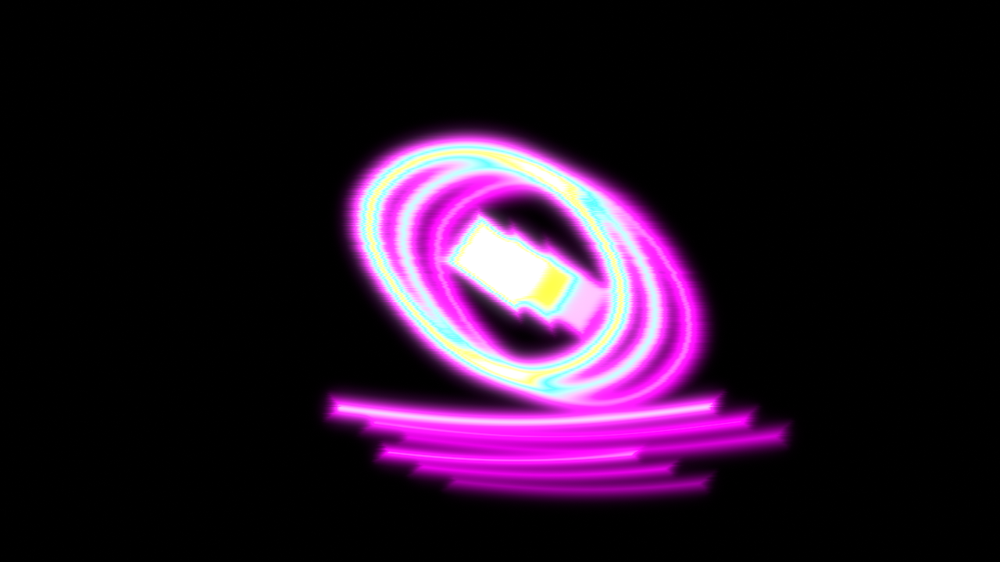

# Scanimate

A Blender compositor filter based on [Scanimate](https://en.wikipedia.org/wiki/Scanimate), the analog scan-conversion system built by Computer Image Corporation and used for television graphics through the early 1980s.

High-contrast artwork on black is rescanned into glowing neon. Deflection coils bend the picture into a sine wave and squeeze it. Extra passes leave a short trail of dimmer copies. Brightness picks a color from a neon ramp, and the display blooms like a CRT.

This is that signal chain. It is not a generic glitch effect.

Verified with **Blender 5.2.2 LTS**. The addon uses the Blender 5 compositor (a compositing node group and a Group Output). It does not run on Blender 4.x.



## Install

Requires Blender 5.0 or newer.

1. Zip the `scanimate` folder so the archive contains `scanimate/__init__.py`:

   ```bash
   zip -r scanimate.zip scanimate
   ```

2. In Blender, open **Edit → Preferences → Add-ons**.
3. Open the menu at the top of the Add-ons list (the down arrow) and choose **Install from Disk…**.
4. Select `scanimate.zip`.
5. Enable **Scanimate**.

Enabling the addon creates a compositor node group named **Scanimate**. The group is created again whenever a file is loaded, so it is available in new scenes.

## Use it on a clip

1. Open the **Compositing** workspace.
2. Add an **Image** node or a **Movie Clip** node with high-contrast art on black.
3. Add **Scanimate** from **Add → Scanimate**, or from **Add → Group → Scanimate**.
4. Connect **Image** (or Movie Clip) → **Scanimate** → **Group Output**.

In Blender 5 the compositing tree’s Group Output is the rendered image. Its first socket is a color socket named Image. That is the socket Scanimate should feed.

Presets are in the node editor sidebar (**Scanimate** tab, press `N`) and in **Add → Scanimate**. Applying a preset writes the values below onto any Scanimate inputs that are not already connected.

## Controls

| Input | What it does |
| --- | --- |
| Image | Artwork or video. The look assumes a bright mark on black. |
| Amplitude | Peak sine deflection, as a fraction of the image. This is the wavy-flag bend. |
| Frequency | How many sine cycles fit across the frame. |
| Phase | Deflection phase in turns. `0` and `1` are the same shape, one cycle apart. |
| Speed | Phase advance in turns per frame. `0` freezes the wave. |
| Squeeze X | Horizontal deflection gain. `1` is unchanged. Higher squeezes the image narrower. Lower stretches it. |
| Squeeze Y | Vertical deflection gain. `1` is unchanged. Higher squeezes the image shorter. Lower stretches it. |
| Jitter | Horizontal shift that changes per scanline, as a fraction of width. |
| Echo Count | Stacked copies, including the original. Integer from 2 to 5. |
| Echo Offset X | Horizontal shift of each echo, as a fraction of width. Positive moves echoes right. |
| Echo Offset Y | Vertical shift of each echo, as a fraction of height. Positive moves echoes up. |
| Echo Decay | Brightness kept by each successive echo. `0.5` halves the brightness every copy. |
| Hue Offset | Rotates the neon ramp. `0` is black → magenta → cyan → yellow → white. |
| Hue Speed | Hue advance in turns per frame. |
| Glow | Soft CRT bloom added back on top of the colored image. `0` is off. |

Deflection is two oscillators. Horizontal position is bent by a sine of Y, so vertical strokes snake. Vertical position is bent by a sine of X, so a straight bar becomes a flag wave. The vertical oscillator runs a quarter turn ahead of the horizontal one. Jitter is a separate per-scanline horizontal offset.

Echoes are added as light. Where copies overlap, the highlight climbs the neon ramp toward white. The ramp itself is black, magenta, cyan, yellow, white. Hue Offset and Hue Speed rotate that result around the hue circle; black and white stay put.

## Presets

| Preset | Look |
| --- | --- |
| Classic Logo | Slow wave, slight vertical squeeze, three copies, classic neon ramp, moderate glow. This is the default. |
| Wave Flag | Large amplitude and two cycles, so bars read as a waving flag. One faint echo. |
| Multi Echo | Almost still deflection and five copies with a slow decay. |
| Hue Cycle | A medium wave and a hue that rotates about once every 80 frames at the default speed. |

## Demo still

`scripts/render_demo.py` draws a high-contrast test card (ring, diamond, two bars on black), installs the addon, runs the Classic Logo preset, and writes `demo/scanimate-still.png`.

```bash
blender --background --factory-startup --python scripts/render_demo.py
```
